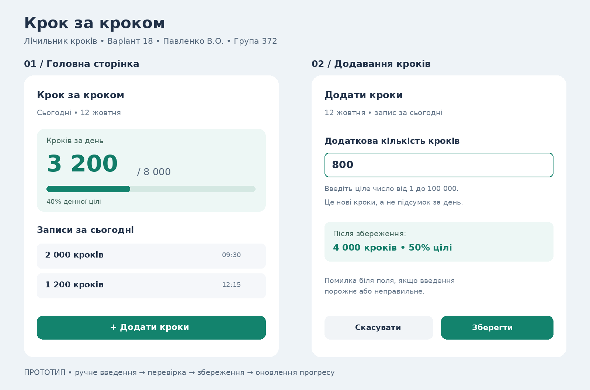

# Лабораторна робота №3

**Тема:** Software Development Life Cycle (SDLC) — життєвий цикл програмного забезпечення.  
**Студент:** Павленко В.О.  
**Група:** 372.  
**Варіант:** 18 — лічильник кроків (імітація).

## 1. Планування

Мета продукту — створити простий застосунок «Крок за кроком», який допомагає відстежувати щоденну фізичну активність.

Користувач повинен мати можливість вручну вводити кількість пройдених кроків, бачити їх загальну кількість за день і прогрес відносно власної денної цілі. Застосунок імітує лічильник: він не використовує датчики телефона. Один запис — це додаткова кількість кроків, а не загальний показник за день.

## 2. Аналіз вимог — User stories

1. **Must have:** Як користувач, я хочу додавати кількість пройдених кроків вручну, щоб зберігати результати своєї активності.
2. **Must have:** Як користувач, я хочу бачити загальну кількість кроків за сьогодні та відсоток виконання денної цілі, щоб оцінювати свій прогрес.
3. Як користувач, я хочу змінювати денну ціль, щоб налаштувати її відповідно до своїх можливостей.
4. Як користувач, я хочу бачити історію доданих записів із датою та часом, щоб перевіряти введені дані.
5. Як користувач, я хочу видаляти помилкові записи, щоб загальна кількість кроків залишалася правильною.

### Правила та обмеження

- Кількість кроків у записі — додатне ціле число від 1 до 100 000. Це обмеження для перевірки введення, а не рекомендація щодо активності.
- Порожні значення, від’ємні числа, нуль, дробові числа та текст не приймаються.
- Денна ціль — додатне ціле число; у прототипі використано приклад 8 000 кроків.
- Підсумок обчислюється тільки за поточну місцеву дату. Записи попередніх днів залишаються в історії.
- Дані зберігаються локально; якщо збереження не вдалося, користувач бачить повідомлення про помилку.
- Відсоток може перевищувати 100%, але графічна шкала заповнюється максимум на 100%.

## 3. Дизайн — прототип



**Екран 1 — головна сторінка.** Показує кількість кроків за сьогодні, денну ціль, відсоток виконання, список записів і кнопку «Додати кроки». Наприклад, записи 2 000 та 1 200 кроків утворюють підсумок 3 200 кроків, тобто 40% цілі 8 000.

**Екран 2 — додавання кроків.** Містить поле введення додаткової кількості кроків, коротке пояснення, поточну дату та кнопки «Зберегти» і «Скасувати». Після успішного збереження користувач повертається на головну сторінку; при неправильному введенні бачить помилку біля поля.

## 4. Реалізація (імітація)

Ключова функція — **додавання запису про кроки та оновлення денного прогресу**. Нижче наведено псевдокод; готовий застосунок у межах цієї роботи не реалізується.

```text
function addSteps(inputText):
    text = trim(inputText)

    if text is empty:
        showError("Введіть кількість кроків")
        return

    if text does not contain only digits:
        showError("Введіть ціле додатне число")
        return

    steps = toInteger(text)
    if steps < 1 or steps > 100000:
        showError("Допустимо від 1 до 100 000 кроків")
        return

    now = currentLocalDateTime()
    today = datePart(now)
    record = {id: generateUniqueId(), steps: steps, createdAt: now}
    updatedRecords = copy(records)
    append(updatedRecords, record)

    if saveLocally(updatedRecords) failed:
        showError("Не вдалося зберегти запис. Спробуйте ще раз")
        return

    records = updatedRecords
    todayTotal = sum(record.steps for record in records
                     where datePart(record.createdAt) == today)
    percent = round(todayTotal / dailyGoal * 100)
    progressBarPercent = min(percent, 100)

    showHome(todayTotal, dailyGoal, percent, progressBarPercent)
    showMessage("Кроки додано")
```

`dailyGoal` має бути перевірена як додатне ціле число до виклику функції. Оновлення списку в пам’яті відбувається лише після успішного збереження.

## 5. Тестування

Наведені перевірки — план тестування функції `addSteps`, а не результати запуску готового застосунку. Якщо не зазначено інакше, початковий підсумок за сьогодні — 3 200 кроків, денна ціль — 8 000.

| № | Вхідні дані / умова | Очікуваний результат |
|---|---|---|
| 1 | Додати `800` | Новий запис збережено; підсумок 4 000, прогрес 50%. |
| 2 | Додати порожній рядок або лише пробіли | Повідомлення «Введіть кількість кроків»; підсумок і список не змінюються. |
| 3 | Додати `-100`, `0`, `2.5` або `abc` (окремі перевірки) | Помилка введення; жодного нового запису. |
| 4 | Додати `100001` | Помилка про допустимий діапазон; підсумок залишається 3 200. |
| 5 | Додати `5000` | Підсумок 8 200, показано 103%; шкала заповнена на 100%. |
| 6 | В історії є 2 000 кроків за вчора; сьогодні додати `800` | Учорашні кроки не включаються в сьогоднішній підсумок; він становить 4 000. |
| 7 | Під час додавання `800` локальне збереження завершується помилкою | Показано помилку збереження; підсумок 3 200, запис не додано до поточного списку. |

## 6. Висновок

Для цього міні-проєкту доцільно застосувати модель **Agile** з короткими ітераціями: спочатку реалізувати ручне додавання кроків і денний прогрес, потім — історію, зміну цілі та видалення записів. Зворотний зв’язок користувачів допоможе поступово покращувати інтерфейс і перевірки введення. Масштаб проєкту невеликий, тому складний процес управління ризиками моделі Spiral не потрібний, а послідовна модель Waterfall буде менш гнучкою при зміні вимог.
